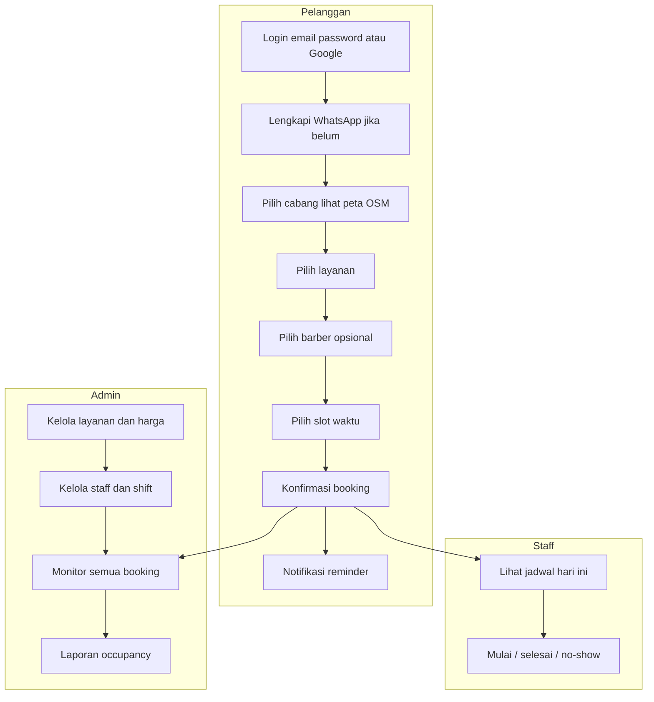
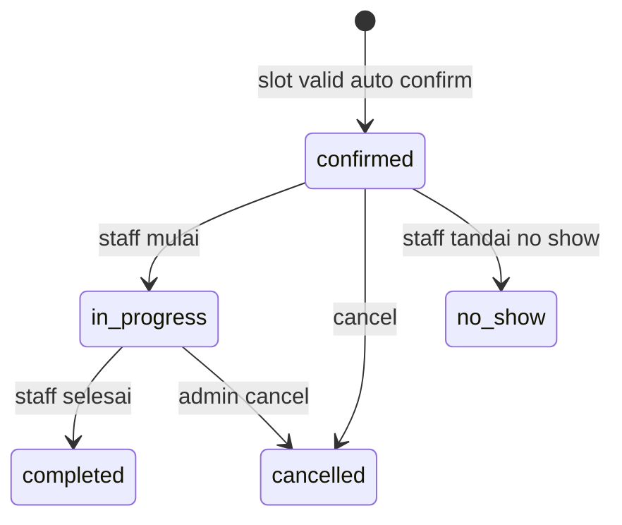
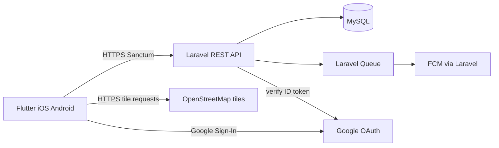
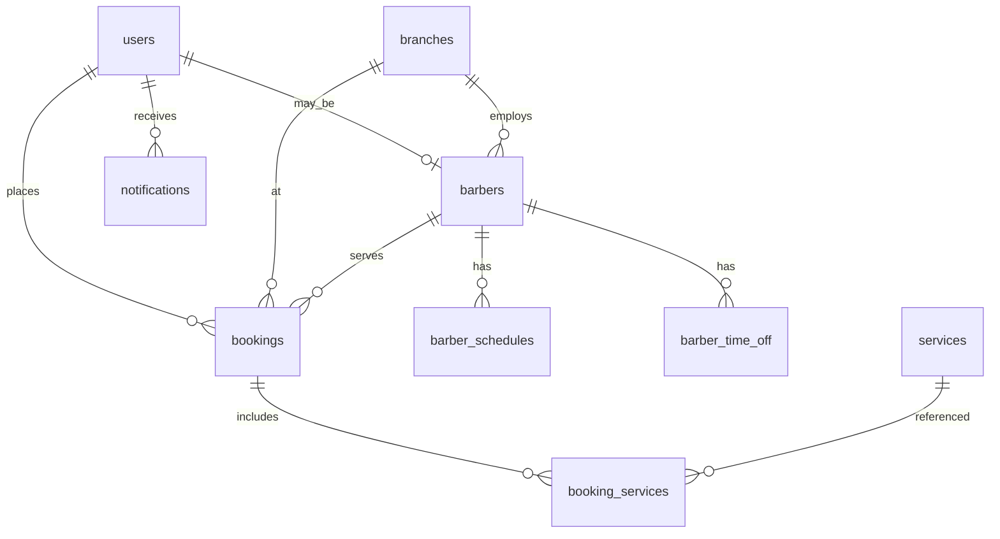

# Product Requirements Document (PRD)

# Aplikasi Booking Barbershop

| | |
|---|---|
| **Versi dokumen** | 1.0 |
| **Tanggal** | 2 November 2025 |
| **Platform klien** | Flutter (iOS & Android) |
| **Backend** | Laravel (REST API) |
| **Status** | Draft — siap acuan implementasi |

---

## Daftar isi

1. [Ringkasan eksekutif](#1-ringkasan-eksekutif)
2. [Tujuan & non-tujuan](#2-tujuan--non-tujuan)
3. [Persona & peran](#3-persona--peran)
4. [Alur bisnis](#4-alur-bisnis)
5. [Functional requirements](#5-functional-requirements)
6. [Non-functional requirements](#6-non-functional-requirements)
7. [Integrasi & dependensi](#7-integrasi--dependensi)
8. [Model data](#8-model-data)
9. [API (kontrak tingkat tinggi)](#9-api-kontrak-tingkat-tinggi)
10. [MVP vs roadmap](#10-mvp-vs-roadmap)
11. [Metrik sukses & acceptance criteria](#11-metrik-sukses--acceptance-criteria)
12. [Keputusan produk & open questions](#12-keputusan-produk--open-questions)
13. [Glosarium](#13-glosarium)

---

## 1. Ringkasan eksekutif

### Masalah

Barbershop sering mengandalkan walk-in, telepon, atau chat WhatsApp manual untuk janji temu. Akibatnya jadwal barber sulit diprediksi, slot kosong atau bentrok, no-show tinggi, dan owner kurang visibility operasional.

### Solusi

Aplikasi mobile **hybrid (Flutter)** dengan backend **Laravel** untuk satu brand barbershop: pelanggan booking slot terstruktur, staff menjalankan layanan dari jadwal harian, admin mengelola master data dan memantau kinerja.

### Target pengguna

- Pelanggan (customer)
- Barber / staff
- Owner / admin

### Diferensiasi

Booking terjadwal dengan availability real-time, notifikasi push, lokasi cabang di **peta OpenStreetMap**, profil pelanggan dengan **WhatsApp wajib** untuk kontak operasional — tanpa kompleksitas marketplace multi-brand di MVP.

### Keputusan produk (ringkas)

| Aspek | Keputusan |
|--------|-----------|
| Model bisnis | Satu barbershop (brand sendiri); struktur data mendukung multi-cabang |
| MVP operasional | Full ops: customer + staff + admin |
| Pembayaran MVP | Bayar di tempat (tanpa payment gateway) |
| Auth customer | Email + password **atau** Sign in with Google |
| Profil customer | Nomor **WhatsApp wajib** |
| Database | **MySQL**; PK **UUID** di semua tabel; **blameable** (`created_at`, `created_by`, `updated_at`, `updated_by` dengan **nama lengkap**) |
| Peta (customer) | **OpenStreetMap** (bukan Google Maps SDK) |
| Repositori | **Satu monorepo** (`mobile/`, `backend/`, `docs/`) — lihat [README.md](../README.md) |
| UI — warna & tipografi | **Primary** `#404040`, **Secondary** `#5E5E5E`, font **Plus Jakarta Sans** ([DESIGN.md](./DESIGN.md)) |

---

## 2. Tujuan & non-tujuan

### Tujuan

- Mengurangi bentrok jadwal dan double-booking barber.
- Menurunkan no-show melalui konfirmasi dan reminder push.
- Memberi staff visibility jadwal harian dan status layanan.
- Memberi owner/admin kontrol layanan, harga, staff, dan laporan occupancy dasar.

### Non-tujuan (MVP)

- Marketplace / SaaS multi-tenant (banyak brand barbershop).
- Payment gateway online (Midtrans, Xendit, dll.).
- Program loyalty / poin / voucher kompleks.
- POS kasir penuh.
- Chat WhatsApp in-app atau blast otomatis via WhatsApp Business API (nomor WA disimpan dan ditampilkan; integrasi API = roadmap).

---

## 3. Persona & peran

### Pelanggan (customer)

- Registrasi/login, kelola profil (termasuk WhatsApp).
- Lihat cabang di peta, katalog layanan, availability, buat & kelola booking.
- Terima notifikasi push (konfirmasi, reminder).

### Barber / staff

- Lihat jadwal booking harian (per barber / cabang sesuai assignment).
- Update status layanan: mulai, selesai, no-show.
- Lihat detail pelanggan (nama, WhatsApp) dan layanan pada booking.

### Owner / admin

- CRUD cabang, layanan, barber/staff, jam kerja, libur.
- Override booking (buat manual, reschedule, cancel).
- Dashboard ringkas: booking hari ini, occupancy, no-show rate.
- Konfigurasi reminder notifikasi.

### RBAC

| Role | Scope |
|------|--------|
| `customer` | Profil sendiri, booking sendiri, katalog & cabang publik |
| `staff` | Jadwal & booking terkait barber/cabang assigned |
| `admin` | Full operasional dalam satu brand barbershop |

Staff dan admin **tidak** self-register; akun dibuat oleh admin (email + password).

---

## 4. Alur bisnis

### Diagram alur



### Kebijakan booking (MVP — default rekomendasi)

| Topik | Aturan |
|--------|--------|
| Slot | Berbasis **durasi layanan** (`duration_minutes`) + buffer opsional **5 menit** antar booking |
| Satu booking MVP | **Satu layanan** per booking (multi-layanan = roadmap / open question) |
| Konfirmasi | **Auto-confirm** setelah slot valid (tanpa approve staff manual) |
| Status | Lihat [Glosarium](#13-glosarium) |
| Double-book | Dilarang per barber; validasi atomik di **Laravel** |
| Cancel customer | Hingga **2 jam** sebelum `start_at` (konfigurasi admin nanti) |
| Cancel admin | Kapan saja dengan audit blameable |
| Reschedule | Customer: cancel + booking baru, atau endpoint reschedule (implementasi) |
| Pembayaran | Hanya **Bayar di tempat**; tidak ada bukti bayar di app MVP |

### Mesin status booking



Catatan: status `pending` opsional jika ke depan ada approve manual; MVP default langsung `confirmed`.

---

## 5. Functional requirements

Prioritas: **Must** | **Should** | **Could** | **Won't** (MVP).

### 5.1 Autentikasi & profil

#### Pelanggan

| ID | Requirement | Prioritas |
|----|-------------|-----------|
| FR-AUTH-01 | Registrasi **email + password** dengan: email, password, **nama lengkap**, **nomor WhatsApp** | Must |
| FR-AUTH-02 | Login **email + password** | Must |
| FR-AUTH-03 | **Sign in with Google**: Flutter Google Sign-In → ID token ke Laravel → token app (Sanctum) | Must |
| FR-AUTH-04 | Setelah login Google pertama: **wajib lengkapi WhatsApp** sebelum booking (gate UI + API) | Must |
| FR-AUTH-05 | Validasi WhatsApp: format Indonesia (+62 / 08…), normalisasi **E.164** di backend | Must |
| FR-AUTH-06 | **WhatsApp unik per akun customer** (default rekomendasi; lihat open questions) | Must |
| FR-AUTH-07 | Lupa password via email reset link | Should |
| FR-AUTH-08 | Verifikasi email | Should |

**Aturan teknis auth**

- Google: verifikasi **ID token** di Laravel; simpan `google_sub`; `password` nullable untuk akun Google-only.
- **Account linking**: jika email Google = email akun password existing → prompt **link account** (login password sekali) atau tolak dengan pesan jelas.
- WhatsApp **bukan** metode login di MVP.

#### Staff & admin

| ID | Requirement | Prioritas |
|----|-------------|-----------|
| FR-AUTH-10 | Admin membuat akun staff/admin (email, nama lengkap, role, cabang) | Must |
| FR-AUTH-11 | Login staff/admin: email + password | Must |
| FR-AUTH-12 | Google login untuk staff | Won't (MVP) |

#### Profil

| ID | Requirement | Prioritas |
|----|-------------|-----------|
| FR-PROF-01 | Customer edit profil: nama, WhatsApp (validasi ulang), foto opsional | Must |
| FR-PROF-02 | Tampilkan email; email dari Google tidak editable sembarangan (kebijakan implementasi) | Should |

---

### 5.2 Katalog, cabang & peta

#### Layanan & cabang

| ID | Requirement | Prioritas |
|----|-------------|-----------|
| FR-CAT-01 | Daftar layanan aktif: nama, deskripsi, durasi, harga | Must |
| FR-CAT-02 | Admin CRUD layanan (aktif/nonaktif) | Must |
| FR-CAT-03 | Cabang: nama, alamat, jam buka (JSON per hari), timezone `Asia/Jakarta` | Must |
| FR-CAT-04 | Cabang aktif wajib **latitude** & **longitude** valid | Must |
| FR-CAT-05 | Admin CRUD cabang termasuk koordinat (input manual atau pick-on-map) | Must |

#### Peta OpenStreetMap (customer)

| ID | Requirement | Prioritas |
|----|-------------|-----------|
| FR-MAP-01 | Halaman pilih/detail cabang: **peta OSM** interaktif (zoom, pan) + marker | Must |
| FR-MAP-02 | Data dari API: lat, lng, name, address, opening_hours | Must |
| FR-MAP-03 | Multi-cabang: daftar + peta (marker per cabang atau fokus cabang terpilih) | Should |
| FR-MAP-04 | **Atribusi OpenStreetMap** visible ([tile usage policy](https://operations.osmfoundation.org/policies/tiles/)) | Must |
| FR-MAP-05 | Tombol **Buka navigasi** → Google Maps / Apple Maps / Waze via koordinat | Should |
| FR-MAP-06 | Fallback: jika tile gagal, tampilkan alamat teks + koordinat | Should |

Implementasi Flutter: **`flutter_map`** + tile layer OSM. **Tidak** memakai Google Maps SDK untuk basemap customer.

---

### 5.3 Booking (pelanggan)

| ID | Requirement | Prioritas |
|----|-------------|-----------|
| FR-BOOK-01 | Alur: cabang → layanan → barber (opsional) → slot → konfirmasi | Must |
| FR-BOOK-02 | Pilih barber spesifik atau **any available** (assign barber otomatis saat confirm) | Must |
| FR-BOOK-03 | API **availability** mengembalikan slot valid saja | Must |
| FR-BOOK-04 | Catatan opsional pada booking | Should |
| FR-BOOK-05 | Metode bayar MVP: **Bayar di tempat** (label di konfirmasi) | Must |
| FR-BOOK-06 | Riwayat booking customer (upcoming + past) | Must |
| FR-BOOK-07 | Cancel booking sesuai kebijakan waktu | Must |

Gate: `POST /bookings` ditolak jika customer belum punya `whatsapp_number` (**422**, code `WHATSAPP_REQUIRED`).

---

### 5.4 Operasional staff

| ID | Requirement | Prioritas |
|----|-------------|-----------|
| FR-STAFF-01 | Daftar booking hari ini untuk barber login / assigned | Must |
| FR-STAFF-02 | Aksi: **in_progress**, **completed**, **no_show** | Must |
| FR-STAFF-03 | Detail booking: pelanggan, WhatsApp, layanan, waktu, catatan | Must |
| FR-STAFF-04 | Blok waktu istirahat / time off (lihat admin) | Could |

---

### 5.5 Admin / owner

| ID | Requirement | Prioritas |
|----|-------------|-----------|
| FR-ADM-01 | CRUD barber + link ke user staff | Must |
| FR-ADM-02 | Jam kerja barber per hari + **time off** (exception dates) | Must |
| FR-ADM-03 | Lihat & filter semua booking | Must |
| FR-ADM-04 | Buat booking manual (walk-in / telepon) | Must |
| FR-ADM-05 | Reschedule & cancel booking (override) | Must |
| FR-ADM-06 | Dashboard: jumlah booking hari ini, occupancy mingguan, no-show rate | Must |
| FR-ADM-07 | Konfigurasi offset reminder push (mis. 24 jam & 2 jam sebelum) | Should |

**Admin UI MVP (default rekomendasi):** role **admin di app Flutter**; panel web Laravel Filament **fase 2** (open question).

---

### 5.6 Notifikasi

| ID | Requirement | Prioritas |
|----|-------------|-----------|
| FR-NOTIF-01 | Push FCM: booking confirmed | Must |
| FR-NOTIF-02 | Push reminder (jadwal konfigurasi admin) | Must |
| FR-NOTIF-03 | Push saat admin reschedule/cancel | Should |
| FR-NOTIF-04 | In-app notification list | Could |

---

## 6. Non-functional requirements

### 6.1 Performa & ketersediaan

| ID | Requirement |
|----|-------------|
| NFR-PERF-01 | Response API availability &lt; **2 detik** pada jaringan normal |
| NFR-PERF-02 | Operasi booking (create) &lt; **3 detik** p95 |
| NFR-AVAIL-01 | Target uptime API production **99.5%** (post-MVP ops) |

### 6.2 Keamanan

| ID | Requirement |
|----|-------------|
| NFR-SEC-01 | HTTPS only; token Sanctum tidak disimpan plain di log |
| NFR-SEC-02 | RBAC enforced di API (policy + middleware) |
| NFR-SEC-03 | Rate limit endpoint auth |
| NFR-SEC-04 | Password hashing bcrypt/argon (Laravel default) |

### 6.3 Lokal & UX

| ID | Requirement |
|----|-------------|
| NFR-LOC-01 | Bahasa UI: **Indonesia** (MVP) |
| NFR-LOC-02 | Timezone bisnis: **Asia/Jakarta** |
| NFR-LOC-03 | Format tanggal/waktu konsisten di API (ISO 8601) |
| NFR-UI-01 | Warna brand: **Primary** `#404040`, **Secondary** `#5E5E5E` — lihat [DESIGN.md](./DESIGN.md) |
| NFR-UI-02 | Theme Flutter konsisten (Material 3); tombol utama primary, aksi sekunder secondary |
| NFR-UI-03 | Tipografi: **Plus Jakarta Sans** (Jakarta Sans) untuk seluruh teks UI — [DESIGN.md](./DESIGN.md) |

### 6.4 Data (UUID & blameable)

| ID | Requirement |
|----|-------------|
| NFR-DATA-01 | Setiap tabel: PK **`id` UUID**, bukan auto-increment |
| NFR-DATA-02 | FK antar tabel: UUID dengan integritas referensial |
| NFR-DATA-03 | JSON API: `id` selalu string UUID |
| NFR-DATA-04 | Tabel pivot: UUID PK + FK UUID |
| NFR-DATA-05 | Setiap tabel bisnis: `created_at`, `created_by`, `updated_at`, `updated_by` |
| NFR-DATA-06 | `created_by` / `updated_by` = **nama lengkap** (`users.name`) saat aksi; tidak diubah retroaktif |
| NFR-DATA-07 | Job sistem / seed: `created_by` & `updated_by` = **`System`** |
| NFR-DATA-08 | Registrasi customer: `created_by` = nama user yang sama |

Implementasi Laravel: `HasUuids` + trait observer **RecordsBlameable**.

### 6.5 Mobile & compliance

| ID | Requirement |
|----|-------------|
| NFR-MOB-01 | Flutter: layering UI → repository → API client |
| NFR-MOB-02 | Offline MVP: **no offline write**; read cache opsional untuk katalog |
| NFR-COMP-01 | Privacy policy URL untuk store listing |
| NFR-COMP-02 | Permission push dengan penjelasan di app |

---

## 7. Integrasi & dependensi

| Integrasi | Penggunaan MVP |
|-----------|----------------|
| **Google OAuth** | Sign in with Google (customer); verifikasi token di Laravel |
| **OpenStreetMap** | Tile peta di Flutter; patuhi attribution & usage policy |
| **FCM** | Push notification (Android + iOS via APNs) |
| **Email** | Reset password, optional verifikasi email |
| **WhatsApp** | Field profil & tampilan di booking; **bukan** API blast MVP |

### Arsitektur



### Struktur monorepo (wajib)

Satu **git repository** di root proyek; backend dan mobile tidak dipisah repo.

```
booking_barbershop/              ← root monorepo
├── README.md
├── .gitignore
├── mobile/                      # Flutter (iOS & Android)
├── backend/                     # Laravel API + MySQL
└── docs/
    ├── PRD.md
    ├── TODO.md
    ├── DESIGN.md
    └── API.md                   # fase berikutnya
```

| ID | Aturan |
|----|--------|
| NFR-REPO-01 | Satu monorepo; CI/CD dapat matrix job `backend` / `mobile` dari root |
| NFR-REPO-02 | Secret env per app: `backend/.env`, config mobile — tidak di-commit (lihat root `.gitignore`) |
| NFR-REPO-03 | Versi API dan app mobile didokumentasikan (tag git atau `CHANGELOG.md` di root — opsional MVP) |

---

## 8. Model data

### 8.1 Relasi konseptual



### 8.2 Entitas (field bisnis + blameable + UUID PK)

Semua tabel memiliki: `id` (UUID), `created_at`, `created_by`, `updated_at`, `updated_by`.

| Entitas | Field penting |
|---------|----------------|
| `users` | `role`, `email`, `password` (nullable), `google_sub`, `name`, `whatsapp_number`, `branch_id` (staff) |
| `branches` | `name`, `address`, `latitude`, `longitude`, `opening_hours` (JSON), `timezone`, `is_active` |
| `services` | `name`, `description`, `duration_minutes`, `price`, `is_active` |
| `barbers` | `user_id`, `branch_id`, `bio`, `is_active` |
| `barber_schedules` | `barber_id`, `day_of_week`, `start_time`, `end_time` |
| `barber_time_off` | `barber_id`, `date`, `reason` |
| `bookings` | `customer_id`, `barber_id`, `branch_id`, `start_at`, `end_at`, `status`, `notes`, `payment_method` |
| `booking_services` | `booking_id`, `service_id`, `price_snapshot`, `duration_snapshot` |
| `notifications` | `user_id`, `type`, `payload` (JSON), `read_at` |

---

## 9. API (kontrak tingkat tinggi)

- **Base:** `/api/v1`
- **Auth:** Laravel **Sanctum** bearer token (mobile)
- **Format:** JSON; identifier UUID string

### Auth & profil

| Method | Path | Keterangan |
|--------|------|------------|
| POST | `/auth/register` | Customer email/password + name + whatsapp |
| POST | `/auth/login` | Email/password |
| POST | `/auth/google` | Body: `id_token` |
| POST | `/auth/logout` | Revoke token |
| POST | `/auth/forgot-password` | Should |
| GET | `/profile` | Profil user login |
| PUT | `/profile` | Update name, whatsapp, foto |

### Cabang & layanan (customer)

| Method | Path | Keterangan |
|--------|------|------------|
| GET | `/branches` | List cabang aktif + lat/lng |
| GET | `/branches/{id}` | Detail cabang |
| GET | `/services` | Layanan aktif (filter `branch_id` jika perlu) |

### Booking & availability

| Method | Path | Keterangan |
|--------|------|------------|
| GET | `/availability` | Query: branch, service, date, barber? |
| GET | `/bookings` | Customer: milik sendiri; staff/admin: scoped |
| POST | `/bookings` | Create; gate WhatsApp |
| GET | `/bookings/{id}` | Detail |
| PATCH | `/bookings/{id}/status` | Staff/admin status transitions |
| POST | `/bookings/{id}/cancel` | Customer/admin cancel |

### Admin (prefix `/admin`, role admin)

CRUD: branches, services, barbers, schedules, time-off, manual booking, dashboard stats.

Detail request/response: [`API.md`](API.md).

---

## 10. MVP vs roadmap

### In scope MVP

- Tiga role, auth (email + Google), WhatsApp wajib
- Katalog, cabang dengan **peta OSM**, booking end-to-end, availability
- Operasi staff & admin (master data, override, dashboard dasar)
- Push notification + reminder
- Bayar di tempat
- UUID + blameable di semua tabel

### Roadmap (post-MVP)

| Fase | Fitur |
|------|--------|
| 2 | Payment gateway, voucher |
| 2 | WhatsApp Business API (reminder/konfirmasi) |
| 2 | Web admin (Filament) |
| 2 | Multi-layanan per booking |
| 3 | Rating & review, loyalty |
| 3 | Multi-cabang skala besar / franchise tooling |

---

## 11. Metrik sukses & acceptance criteria

### Metrik (3 bulan post-launch — contoh)

| Metrik | Target |
|--------|--------|
| % booking via app vs walk-in | &gt; 40% |
| No-show rate | Turun 20% vs baseline manual |
| Double-book incident | 0 per bulan |
| Crash-free sessions (mobile) | &gt; 99% |

### Acceptance criteria per epic

**Epic Auth & profil**

- Register/login email-password dan Google berhasil; token Sanctum valid.
- User Google tanpa WhatsApp tidak bisa booking; diarahkan lengkapi profil.
- Staff tidak bisa register tanpa admin.

**Epic Cabang & peta**

- Marker cabang tampil di OSM dengan data API; atribusi OSM terlihat.
- Cabang aktif punya lat/lng; admin bisa update.

**Epic Data & API**

- Semua `id` di response UUID string.
- Create/update mengisi blameable dengan nama lengkap user; job sistem = `System`.

**Epic Booking**

- Slot bentrok ditolak server.
- Staff hanya lihat booking scope assigned.
- Layanan nonaktif tidak muncul di katalog.
- Reminder terkirim sesuai konfigurasi (staging).

### MoSCoW Sprint 1 (usulan)

| Must (Sprint 1) | Should | Could |
|-----------------|--------|-------|
| Auth email + Google + WhatsApp gate | Lupa password | In-app notifications |
| UUID + blameable migrations | Email verify | Staff time-off self-service |
| Branches + services read API | OSM navigasi eksternal | Deep link booking |
| Availability + create booking | FR-NOTIF-03 | |
| Staff list + status update | Dashboard admin lengkap | |
| OSM map cabang | | |
| FCM confirmed + 1 reminder | | |

---

## 12. Keputusan produk & open questions

### Sudah diputuskan

- Satu brand barbershop; full ops MVP; bayar di tempat
- Auth customer: email/password + Google; WhatsApp wajib
- UUID PK + blameable (nama lengkap) semua tabel
- Peta customer: OpenStreetMap
- Backend Laravel; klien Flutter; database **MySQL**; **monorepo tunggal**
- Warna UI: primary `#404040`, secondary `#5E5E5E`; font **Plus Jakarta Sans**

### Open questions

Keputusan final: **[DECISIONS.md](./DECISIONS.md)** (default PRD diterima, Fase 0).

| # | Pertanyaan | Status |
|---|------------|--------|
| 1 | Multi-cabang di MVP? | **1 cabang** — lihat DECISIONS |
| 2 | Admin UI | **Flutter admin** MVP |
| 3 | Auto-confirm | **Ya** |
| 4 | Multi-layanan | **Tidak** MVP |
| 5 | WhatsApp unik | **Ya** |

### Risiko & mitigasi

| Risiko | Mitigasi |
|--------|----------|
| Beban tile OSM | Patuhi policy; pertimbangkan tile CDN/commercial jika traffic tinggi |
| No-show tetap tinggi | Reminder push + tampilkan kebijakan cancel |
| Google sign-in ditolak store | Sediakan email/password selalu |

### Asumsi

- Barbershop punya smartphone staff & koneksi internet di operasional.
- Admin mengisi koordinat cabang dengan benar.
- Pelanggan punya WhatsApp aktif.

---

## 13. Glosarium

| Istilah | Definisi |
|---------|----------|
| **Blameable** | Kolom audit: `created_at`, `created_by`, `updated_at`, `updated_by` (nama lengkap) |
| **Booking** | Janji temu pelanggan dengan barber pada slot waktu tertentu |
| **Availability** | Slot waktu yang valid (jam buka, jadwal barber, durasi layanan, booking existing) |
| **Occupancy** | Proporsi slot terisi vs slot tersedia |
| **Status `confirmed`** | Booking disetujui sistem (auto-confirm MVP) |
| **Status `in_progress`** | Layanan sedang berjalan |
| **Status `completed`** | Layanan selesai |
| **Status `cancelled`** | Dibatalkan customer/admin |
| **Status `no_show`** | Pelanggan tidak hadir |
| **E.164** | Format internasional nomor telepon (mis. +62812…) |
| **OSM** | OpenStreetMap |

---

## Riwayat perubahan dokumen

| Versi | Tanggal | Perubahan |
|-------|---------|-----------|
| 1.0 | 2025-11-02 | Draft awal PRD |
| 1.1 | 2025-11-02 | MySQL; palet warna primary/secondary |
| 1.2 | 2025-11-02 | Tipografi Plus Jakarta Sans |
| 1.3 | 2025-11-02 | Struktur monorepo tunggal |
